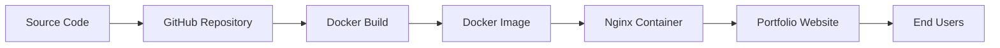

# 🚀 Ayush Kumar Singh | Personal Portfolio

<p align="center">
  
</p>

<h3 align="center">
Cloud Computing | DevOps | Big Data Analytics | Full Stack Development
</h3>

<p align="center">
  
  
  
  
  
</p>

---

## 📌 About the Portfolio

A modern, responsive personal portfolio website showcasing my professional journey, technical expertise, internship experience, certifications, and engineering projects.

I am a B.Tech Computer Science Engineering student specializing in Cloud Computing at Manav Rachna International Institute of Research and Studies.

My interests include cloud infrastructure, DevOps automation, containerization, big data processing, artificial intelligence, and scalable full-stack applications.

---

## ✨ Features

- Modern and responsive user interface
- Dynamic typing animations
- Professional profile and introduction
- Dedicated internship experience section
- Featured technical projects
- Categorized technical skills
- Education and certifications
- Downloadable professional resume
- GitHub and LinkedIn integration
- Email-based contact functionality
- Mobile-friendly navigation
- Docker-based deployment support

---

## 🛠️ Technical Skills

### Cloud Computing


- Amazon EC2
- Amazon S3
- Amazon CloudFront
- Azure Blob Storage
- Vercel

### DevOps & Infrastructure


- Docker Compose
- CI/CD Pipelines
- Git and GitHub
- Nginx Reverse Proxy
- Linux and SSH
- Prometheus and Grafana

### Big Data & Artificial Intelligence


- Apache Spark
- PySpark
- Spark SQL
- Pandas
- Data Quality Analysis
- Google Gemini AI Integration

### Full Stack Development


- HTML5, CSS3 and JavaScript
- React.js
- Node.js and Express.js
- Python FastAPI
- REST APIs
- WebSockets and Socket.IO

### Databases


---

## 💼 Professional Experience

### Maincrafts — Cloud Computing & DevOps Intern

**June 2026 – July 2026**

- Developed automated CI/CD pipelines using GitHub Actions.
- Deployed containerized applications on AWS EC2.
- Hosted static websites using AWS S3 and CloudFront.
- Implemented Nginx reverse proxy configurations.
- Configured secure deployment workflows with GitHub Secrets.
- Orchestrated multi-service environments using Docker Compose.
- Integrated PostgreSQL, Redis, Prometheus, and Grafana.
- Implemented five sequential deployment quality gates.

### CodTech IT Solutions — Full Stack Developer Intern

**July 2025 – August 2025**

- Developed four applications using modern web technologies.
- Built a real-time chat application using Socket.IO.
- Developed a collaborative document editor with WebSocket synchronization.
- Created a Chrome extension for productivity tracking.
- Integrated REST APIs and asynchronous JavaScript.
- Developed responsive and interactive user interfaces.

---

## 🚀 Featured Projects

### 1. DataSphere AI — Cloud-Based Big Data Analytics Platform

A cloud-integrated big data analytics platform designed to process datasets, generate interactive visualizations, and deliver AI-powered insights.

**Key Features:**

- Apache Spark-based dataset processing
- Azure Blob Storage integration
- Interactive analytics dashboards
- Financial performance trend analysis
- Industry comparison and category distribution
- Automated data quality analysis
- Spark SQL Lab
- Gemini AI-powered Copilot
- Multiple dataset format support
- Configured file upload limit of 5 GB
- User authentication and session management

**Technology Stack:** React.js, Recharts, Python, FastAPI, Apache Spark, PySpark, Pandas, Spark SQL, SQLite, Azure Blob Storage, Gemini AI.

### 2. Automated Cloud Deployment & Monitoring Pipeline

An end-to-end cloud deployment pipeline designed to automate application delivery and infrastructure monitoring.

**Key Features:**

- Automated Docker image builds
- Docker Hub integration
- AWS EC2 deployment
- GitHub Actions CI/CD
- Five sequential quality gates
- Nginx reverse proxy
- Multi-container orchestration
- Persistent database storage
- Prometheus metrics collection
- Grafana monitoring dashboards

**Technology Stack:** AWS EC2, S3, CloudFront, Docker, Docker Compose, GitHub Actions, Nginx, PostgreSQL, Redis, Prometheus, Grafana.

### 3. Real-Time Chat Application

An event-driven messaging application supporting real-time communication between multiple concurrent users.

**Key Features:**

- Instant messaging
- WebSocket communication
- Event-driven backend architecture
- RESTful backend services
- Multi-user communication
- Responsive user interface

**Technology Stack:** Node.js, Express.js, Socket.IO, WebSockets, JavaScript.

### 4. Weather Forecast Web Application

A responsive weather application providing real-time weather information using external APIs.

**Key Features:**

- Automatic location detection
- Real-time weather information
- Temperature and humidity monitoring
- Wind speed and atmospheric pressure
- Visibility information
- Asynchronous API integration
- Responsive interface

**Technology Stack:** HTML, CSS, JavaScript, OpenWeather API, Vercel.

---

## 🎓 Education

| Qualification | Institution | Duration | Result |
|---|---|---|---|
| B.Tech CSE (Cloud Computing) | Manav Rachna International Institute of Research and Studies | 2023–2027 (Expected) | 7.3/10 CGPA |
| Class XII (PCM) | National Public School | 2022–2023 | 65% |
| Class X | National Public School | 2020–2021 | 80% |

---

## 🏆 Certifications & Achievements

| Certification / Achievement | Organization | Date |
|---|---|---|
| Oracle Cloud Infrastructure Certified Foundations Associate | Oracle University | July 2026 |
| AZ-305: Designing Microsoft Azure Infrastructure Solutions — Exam Passed (900/1000) | Microsoft | June 2026 |
| Salesforce Platform Developer | Infosys | February 2026 |
| Gen AI Mastermind | OutSkill Private Limited | October 2025 |
| Oracle Certified Professional | Oracle University | May 2025 |
| Microsoft Azure AI Fundamentals | Microsoft | February 2025 |

---

## 📂 Project Structure

```text
personal-portfolio/
│
├── images/
│   └── profile.png
│
├── index.html
├── style.css
├── script.js
├── Dockerfile
├── Ayush_Kumar_Singh_Resume.pdf
└── README.md
```

---

## ⚙️ Installation and Local Setup

### Prerequisites

- Git
- Visual Studio Code
- Modern web browser
- Docker Desktop (optional)

### Clone the Repository

Copy the HTTPS URL from the GitHub repository and run:

```bash
git clone YOUR_REPOSITORY_URL
```

### Navigate to the Project Directory

```bash
cd personal-portfolio
```

### Open in Visual Studio Code

```bash
code .
```

Open `index.html` directly in your browser or use the Live Server extension in Visual Studio Code.

---

## 🐳 Docker Deployment

The portfolio supports containerized deployment using Docker and Nginx.

### Step 1: Build the Docker Image

```bash
docker build -t personal-portfolio .
```

### Step 2: Run the Docker Container

```bash
docker run -d --name portfolio-container -p 8080:80 personal-portfolio
```

### Step 3: Verify the Container

```bash
docker ps
```

### Step 4: Access the Website

Open the following URL in your browser:

```text
http://localhost:8080
```

### Stop the Container

```bash
docker stop portfolio-container
```

### Remove the Container

```bash
docker rm portfolio-container
```

---

## ☁️ Deployment Architecture



The website can also be deployed using:

- GitHub Pages
- Vercel
- Netlify
- AWS EC2
- AWS S3 and CloudFront
- Docker-compatible hosting platforms

---

## 🔮 Future Enhancements

- Automated CI/CD deployment
- Dark and light theme toggle
- Dynamic project management
- Backend-powered contact form
- AI-powered portfolio assistant
- Website analytics integration
- Cloud infrastructure monitoring
- Automated security scanning
- Custom domain and HTTPS configuration

---

## 📄 Resume

Download my latest professional resume:

[Download Resume](./Ayush_Kumar_Singh_Resume.pdf)

---

## 🤝 Connect With Me

<p align="left">
  <a href="https://github.com/Asr1403">
    
  </a>
  <a href="https://www.linkedin.com/in/ayush-singh1403">
    
  </a>
  <a href="mailto:Ayushsingh14005@gmail.com">
    
  </a>
</p>

**Location:** New Delhi, India

**Career Interests:**

- Cloud Engineer
- DevOps Engineer
- Data Engineer
- Full Stack Developer
- Software Engineer

---

## ⭐ Support

If you find this portfolio interesting, consider giving the repository a star.

Feedback and suggestions are always welcome.

---

<p align="center">
  Designed and Developed by <b>Ayush Kumar Singh</b>
</p>

<p align="center">
  Cloud Computing • DevOps • Big Data • Artificial Intelligence
</p>

<p align="center">
  © 2026 Ayush Kumar Singh. All Rights Reserved.
</p>
